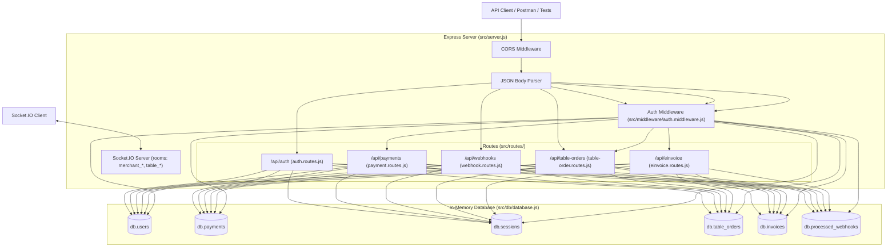

# EU Pay QA Technical Assessment - System Reconnaissance

## 1. Executive Summary & Reconnaissance Scope
This document provides a comprehensive technical overview and QA reconnaissance of the EU Pay Payment Processing API codebase prior to bug reproduction, fixing, and automated test implementation.

---

## 2. Application Architecture



- **Runtime & Framework**: Node.js (ES Module format, `"type": "module"`), Express 4.18.2, HTTP Server with integrated Socket.IO 4.7.2 server.
- **State Management / Persistence**: In-memory database object in `src/db/database.js` reset upon process restart.
- **Security & Cryptography**: `jsonwebtoken` (24-hour expiration tokens), `bcryptjs` (salt rounds 10), Node.js native `crypto` module.

---

## 3. API Endpoints Catalog

| HTTP Method | Path | Auth Required | Description | Request Body / Parameters |
|---|---|---|---|---|
| `GET` | `/` | No | API status, feature list, endpoints metadata | None |
| `POST` | `/api/auth/register` | No | Register new merchant account & generate JWT | `{ email, password, business_name }` |
| `POST` | `/api/auth/login` | No | Merchant login & generate JWT | `{ email, password }` |
| `GET` | `/api/payments` | Yes (Bearer JWT) | List all payments for authenticated merchant | Header: `Authorization: Bearer <token>` |
| `GET` | `/api/payments/:id` | Yes (Bearer JWT) | Fetch single payment details (ownership verified) | Param: `id` |
| `POST` | `/api/payments` | Yes (Bearer JWT) | Create new payment intent | `{ amount, currency, customer_email }` |
| `POST` | `/api/webhooks/payment-status` | No (Header signature) | Inbound PSP status webhook | Header: `x-webhook-signature`, Body: `{ payment_id, status, event_id }` |
| `POST` | `/api/webhooks/e-invoice` | No | Inbound Tax Authority status webhook | `{ invoice_id, status, submission_id, tax_authority_id }` |
| `GET` | `/api/table-orders` | Yes (Bearer JWT) | List orders for authenticated merchant | Header: `Authorization: Bearer <token>` |
| `POST` | `/api/table-orders` | No | Create restaurant table order | `{ merchant_id, table_number, items, customer_name, order_type }` |
| `PATCH` | `/api/table-orders/:id/status` | Yes (Bearer JWT) | Update table order status | Param: `id`, Body: `{ status }` |
| `POST` | `/api/einvoice/submit` | Yes (Bearer JWT) | Submit invoice to Seqino PDP / Tax authority | `{ invoice_id, customer_siret }` |
| `GET` | `/api/einvoice/status/:invoice_id` | Yes (Bearer JWT) | Query tax authority submission status | Param: `invoice_id` |

---

## 4. End-to-End System Flows

### 4.1 Authentication Flow
1. **Registration (`POST /api/auth/register`)**:
   - Accepts `email`, `password`, `business_name`.
   - Validates email format, password length ($\ge 8$), business name ($\ge 2$ characters).
   - Verifies email uniqueness against `db.users`.
   - Hashes password using `bcrypt.hash(password, 10)`.
   - Inserts new merchant into `db.users` with type `merchant`.
   - Issues 24-hour signed JWT containing `{ id, email, type }`.
2. **Login (`POST /api/auth/login`)**:
   - Accepts `email`, `password`.
   - Finds user in `db.users` by email.
   - Compares password using `bcrypt.compare`.
   - Issues 24-hour signed JWT.
3. **Authentication Middleware (`src/middleware/auth.middleware.js`)**:
   - Intercepts requests requiring credentials.
   - Extracts and verifies `Authorization: Bearer <token>` using `JWT_SECRET`.
   - Re-checks that the user ID exists in the database.
   - Attaches `req.user = { id, email, type }` to downstream request context.

### 4.2 Payment Flow
1. **Creation (`POST /api/payments`)**:
   - Merchant authenticates via JWT.
   - Submits `amount`, `currency` (`EUR`, `USD`, `GBP`), and `customer_email`.
   - Validates basic types, positivity, and presence.
   - Saves record into `db.payments` with `status: "pending"` and assigns merchant ID.
2. **Retrieval (`GET /api/payments` & `GET /api/payments/:id`)**:
   - Fetches payments filtered by `merchant_id === req.user.id`.
   - Formats fields and returns array / payment object.

### 4.3 Webhook Flow
1. **Payment Status Webhook (`POST /api/webhooks/payment-status`)**:
   - PSP sends payload with `payment_id`, `status`, and `event_id`.
   - Intended to verify HMAC-SHA256 signature against `WEBHOOK_SECRET` passed via `x-webhook-signature`.
   - Intended to enforce idempotency via `event_id` tracking.
   - Locates payment in `db.payments` and updates `status` and `webhook_received_at`.
2. **E-Invoice Tax Webhook (`POST /api/webhooks/e-invoice`)**:
   - Tax authority simulator sends `invoice_id`, `status`, `submission_id`, `tax_authority_id`.
   - Updates corresponding record in `db.invoices`.

### 4.4 Table-Order Flow
1. **Order Creation (`POST /api/table-orders`)**:
   - Public customer/table interface sends `merchant_id`, `table_number`, `items: [{ name, price, quantity }]`.
   - Calculates order total sum.
   - Assigns UUID `id`, sets `status: "pending"`.
   - Appends to `db.table_orders`.
2. **Order Listing & Status Updates (`GET /api/table-orders`, `PATCH /api/table-orders/:id/status`)**:
   - Authenticated merchant queries pending/active table orders.
   - Merchant transitions status (`pending` $\rightarrow$ `confirmed` $\rightarrow$ `preparing` $\rightarrow$ `ready` $\rightarrow$ `served` $\rightarrow$ `cancelled`).

### 4.5 E-Invoice Flow
1. **Submission (`POST /api/einvoice/submit`)**:
   - Authenticated merchant provides `invoice_id` and 14-digit French B2B `customer_siret`.
   - Validates SIRET length and merchant ownership.
   - Sets `einvoice_status: "submitted"`, generates unique `submission_id`.
2. **Status Polling (`GET /api/einvoice/status/:invoice_id`)**:
   - Authenticated merchant fetches current filing status (`submitted`, `accepted`, `rejected`).

---

## 5. Database Structure & Seed Data

The in-memory database (`src/db/database.js`) maintains 6 collections:

- **`users`**:
  ```json
  [
    {
      "id": "1",
      "email": "merchant@test.com",
      "password": "<bcrypt_hash_for_Test123!>",
      "business_name": "Test Merchant",
      "type": "merchant",
      "created_at": "Date"
    }
  ]
  ```
- **`payments`**:
  ```json
  [
    {
      "id": "1",
      "merchant_id": "1",
      "amount": 25.5,
      "currency": "EUR",
      "status": "completed",
      "customer_email": "customer1@test.com",
      "created_at": "Date"
    },
    {
      "id": "2",
      "merchant_id": "1",
      "amount": 100.0,
      "currency": "EUR",
      "status": "pending",
      "customer_email": "customer2@test.com",
      "created_at": "Date"
    }
  ]
  ```
- **`sessions`**: `[]`
- **`table_orders`**: `[]`
- **`invoices`**: `[]`
- **`processed_webhooks`**: `[]`

---

## 6. Socket.IO Real-Time Architecture

The server establishes a WebSocket endpoint listening on the primary HTTP port:
- **Connection**: `io.on('connection', socket)`
- **Rooms**:
  - `socket.on('join_merchant', merchantId)` $\rightarrow$ Joins room `merchant_${merchantId}` for merchant dashboard notifications.
  - `socket.on('join_table', tableNumber)` $\rightarrow$ Joins room `table_${tableNumber}` for diner updates.
- **Events**:
  - `new_order`: Broadcast when a table order is submitted.
  - `order_status_changed`: Broadcast when merchant changes order status.

---

## 7. Existing Test Configuration

- **Runner**: Node.js Built-in Test Runner (`node --test`)
- **Execution Command**: `npm test` runs `node --test src/**/*.test.js`
- **Verification Script**: `npm run verify-bugs` executes `scripts/verify-bugs.js`
- **Existing Test Files**:
  - `src/routes/__tests__/auth.routes.test.js` (placeholder test)
  - `src/routes/__tests__/payment.routes.test.js` (placeholder test)
- **Target Test Files Needed**:
  - `src/routes/__tests__/auth.routes.test.js`
  - `src/routes/__tests__/payment.routes.test.js`
  - `src/routes/__tests__/webhook.routes.test.js`
  - `src/routes/__tests__/table-order.routes.test.js`
  - `src/routes/__tests__/einvoice.routes.test.js`

---

## 8. Bug Investigation Matrix

| Bug ID | Component | Suspected Endpoint | What Behavior Should Be Tested | Test Type | Expected Result | Actual Result | Severity |
|---|---|---|---|---|---|---|---|
| **Bug A** | Payment API | `GET /api/payments`<br>`GET /api/payments/:id` | Data type returned for the `amount` field in the response body. | Contract / API Functional Test | `typeof response.data[0].amount === 'number'` (e.g. `25.5`) | **REPRODUCED**: `amount` is returned as a JSON string (`"25.5"`, `typeof === 'string'`) instead of numeric type. | Medium |
| **Bug B** | Payment API | `POST /api/payments` | Upper boundary limit validation for transaction amounts (e.g. amounts exceeding maximum business ceiling of €50,000 such as `999999999`). | Boundary / Negative Test | HTTP 400 Bad Request with descriptive error rejecting amount over limit. | **REPRODUCED**: Amounts > €50,000 (e.g., 50000.01, 999999, 999999999) are accepted with HTTP 201 and created in the database due to missing maximum threshold validation. | High |
| **Bug C** | Auth API | `POST /api/auth/register` | Email syntactic validation with domain formats lacking a top-level domain (e.g. `user@domain` or `merchant@invalid`). | Input Validation / Negative Test | HTTP 400 Bad Request with error indicating invalid email format. | **REPRODUCED**: Email regex `/^[^\s@]+@[^\s@]+$/` accepts emails lacking a top-level domain (TLD) such as `user2@domain` and `user7@example`, creating merchant accounts with HTTP 201. | Medium |
| **Bug D** | Webhooks | `POST /api/webhooks/payment-status` | Security verification of the HMAC-SHA256 signature provided in the `x-webhook-signature` header against unauthorized/spoofed requests. | Security / Authentication Test | HTTP 401 Unauthorized when signature is missing, forged, or invalid. | **REPRODUCED**: The endpoint completely lacks signature verification, returning HTTP 200 and mutating payment statuses for missing, invalid, random hex, and wrong HMAC signatures. | Critical |
| **Bug E** | Webhooks | `POST /api/webhooks/payment-status` | Idempotent handling of duplicate webhook event deliveries sharing the same `event_id`. | Idempotency / Integration Test | HTTP 200 with acknowledgment indicating event was already processed without duplicate state mutations. | **REPRODUCED**: No idempotency tracking is performed. Re-sending identical or conflicting payloads with the same `event_id` triggers full state re-processing every time (e.g. 5/5 concurrent duplicate requests accepted). | High |
| **Bug F** | Table Orders | `POST /api/table-orders` | Prevention of duplicate active orders for the same table at the same merchant when an order is already pending. | Business Logic / Negative Test | HTTP 409 Conflict indicating that table already has an active pending order. | **REPRODUCED**: `POST /api/table-orders` allows creating multiple simultaneous pending orders for the same table at the same merchant (both accepted with HTTP 201). | Medium |
| **Bug G** | E-Invoice | `POST /api/einvoice/submit` | Duplicate submission prevention when an invoice has already been submitted or accepted by the tax authority. | State Validation / Business Logic Test | HTTP 409 Conflict indicating that the invoice has already been submitted. | **REPRODUCED**: `POST /api/einvoice/submit` allows re-submitting an already submitted invoice multiple times, generating a new `submission_id` each time with HTTP 200 instead of returning HTTP 409 Conflict. | Medium |

---

## 9. Next Steps
1. Execute manual and automated baseline reproduction tests against live API server.
2. Confirm reproduction of each bug (A through G) and record observed results.
3. Review findings with team before proceeding to Phase 2 (Bug Fixing).
